<p align="center">
  
</p>

<p align="center">
  <code>▶ NEW GAME</code>&nbsp;&nbsp;&nbsp;
  <a href="https://data-specialist-portfolio.vercel.app/"><code>CONTINUE (portfolio)</code></a>&nbsp;&nbsp;&nbsp;
  <a href="https://medium.com/@estevaolins94"><code>CODEX (articles)</code></a>&nbsp;&nbsp;&nbsp;
  <a href="mailto:estevaolins94@gmail.com"><code>SEND RAVEN</code></a>
</p>

---

## 🧙 CHARACTER SHEET

```text
╔══════════════════════════════════════════════════════════════╗
║  NAME ......... Estevão Lins Maia                            ║
║  CLASS ........ Data Engineer                                ║
║  GUILD ........ Tilt (since Jan 2026)                        ║
║  REGION ....... Brazil                                       ║
║  ALIGNMENT .... Lawful Pipeline                              ║
║  SPECIAL MOVE . Turns messy sources into clean, trusted data ║
╠══════════════════════════════════════════════════════════════╣
║  HP  ██████████████████████  ∞   (coffee-powered)            ║
║  MP  ████████████████░░░░░░  80  (regenerates on green CI)   ║
║  XP  ███████████████░░░░░░░  → next level: Airflow           ║
╚══════════════════════════════════════════════════════════════╝
```

## ⚔️ CAMPAIGN LOG

### 🏰 Chapter 2 — TILT &nbsp;`JAN 2026 → PRESENT` &nbsp;🟢 *active quest*

**Class:** Data Engineer &nbsp;·&nbsp; **Loot:** Snowflake · dbt · Python · GitHub Actions · Datadog · Sigma

**🏆 Achievements unlocked**

- **Pipeline Forger:** built scalable ETL/ELT pipelines on **Snowflake** with **dbt** and **Python**, using spec-driven development (SDD) to power predictive analytics workflows and improve operational efficiency.
- **CI/CD Automaton:** set up end-to-end **CI/CD with GitHub Actions** for dbt, combining spec-driven development with AI-assisted test harnesses across the whole data development lifecycle.
- **All-Seeing Eye:** integrated **Datadog** with GitHub to unify pipeline orchestration and monitoring, significantly cutting the time spent maintaining observability dashboards.
- **Platform Architect:** designed and shipped a data application platform for stakeholders that brings together customer analytics, historical log analysis and interactive **Sigma** BI dashboards linked to the Snowflake schema catalog.
- **Keeper of the Tests:** own data validation, end-to-end testing and documentation in dbt, keeping the data team aligned on exactly what each data product delivers.
- **Product Guardian:** own data products covering leave success, Jira KPIs, contract forecasting, and company spend on AI, data platforms and coding tools.

### 🏛️ Chapter 1 — SICOOB &nbsp;`COMPLETED` ✔

**Class:** Data Engineer

## 🌳 SKILL TREE

```text
 MAIN WEAPONS                            IN TRAINING 🔥
 ──────────────────────────────          ──────────────────────────────
 Python     [■■■■■■■■■□]  MASTERY        Airflow    [■■■■■■□□□□]  +XP
 SQL        [■■■■■■■■■□]  MASTERY
 dbt        [■■■■■■■■□□]  MASTERY
 Snowflake  [■■■■■■■■□□]  MASTERY
 Spark      [■■■■■■■■□□]  MASTERY

 PASSIVES: data modeling · CI/CD · observability · spec-driven development
```

> 💬 **Talk to me in the tavern about:** Python, Spark, SQL, dbt and Snowflake.

## 🎒 INVENTORY

| Slot | Equipped items |
|:--|:--|
| ⚔️ **Weapons** |     |
| 🛡️ **Armor (data stores)** |      |
| 🌀 **Spells (orchestration & CI/CD)** |    |
| 🔭 **Scrying orbs (BI & observability)** |   |
| ☁️ **Mounts (cloud)** |    |
| 🔮 **Artifacts (ML & vision)** |    |

## 📜 QUEST LOG

- [x] **Chapter 1:** Complete the Sicoob campaign as a Data Engineer
- [x] **Chapter 2:** Join the Tilt guild (Jan 2026)
- [ ] **Active quest:** Master Airflow, *in progress…*
- [ ] **Side quest:** Team up on **Data Automation & Engineering** projects → [open a party invite](mailto:estevaolins94@gmail.com)
- [ ] **Side quest:** Keep writing to the [Codex on Medium](https://medium.com/@estevaolins94)

## 📖 CODEX — latest entries

<!-- BLOG-POST-LIST:START -->
<!-- BLOG-POST-LIST:END -->

## 🗺️ WORLD MAP

<p align="center">
  <a href="https://data-specialist-portfolio.vercel.app/"></a>
  <a href="https://www.linkedin.com/in/estevaolins/"></a>
  <a href="https://www.kaggle.com/estevaolins"></a>
  <a href="https://medium.com/@estevaolins94"></a>
</p>

## 🐍 BOSS FIGHT — the contribution snake

<p align="center">
  <picture>
    <source media="(prefers-color-scheme: dark)" srcset="https://raw.githubusercontent.com/YOUR_GITHUB_USER/YOUR_GITHUB_USER/output/snake-dark.svg"/>
    
  </picture>
</p>

<details>
<summary>🕹️ <b>Cheat codes</b> (click to unlock)</summary>
<br>

```text
↑ ↑ ↓ ↓ ← → ← → B A   →   SELECT * FROM opportunities WHERE you = 'hiring';
```

📫 `estevaolins94@gmail.com` — rewards guaranteed for collaboration quests.

</details>

<p align="center"><code>GAME SAVED ✔ — thanks for visiting, player 2.</code></p>
